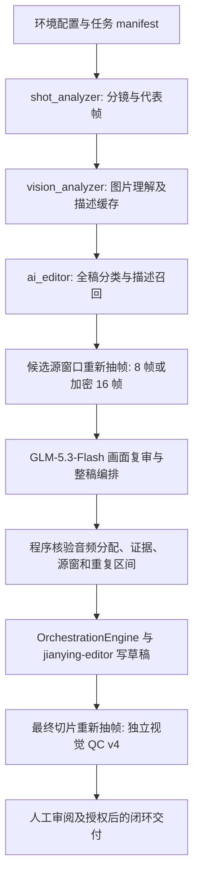

# 体系结构

当前维护入口为 `packages/video-v1.5.3/`，真实版本读包内 `VERSION`。默认选镜为 `ai_editor`，视觉后端为火山方舟直连 **GLM-5.3-Flash**（`glm-5.3-flash`）。配置和覆盖优先级见[模型与视觉流程](model-and-vision.md)。

## 默认数据流

1. **输入与环境**：外部注入路径/凭据；`platform_env.environment_report()` 检查本地依赖和草稿根。它不证明云端凭据可用，也不证明渲染机已升级。
2. **素材理解**：`shot_analyzer.analyze_manifest` 做场景切分和抽帧；`vision_analyzer.enrich_with_vision` 通过带标记的拼图获得描述、标签、动作和证据区间。有效缓存可复用，错误或缺字段不能补成观察成功。
3. **AI 选镜**：`cli._temporary_match → ai_editor.prepare → shot_analyzer.match_manifest`。描述只用于全稿分类和候选召回；卖点候选需重新看实际像素。候选不明确时加密观察，未知项与确定缺素材分别报告。AI 负责语义和编排，程序重验实际素材、窗口、证据和音频分配。
4. **建稿**：引擎依次检查环境、口播/音色、证据、容量、时序、转场/BGM，安全调用 `jianying-editor`。产出草稿、`report/`、`last_result.json` 和任务事件。建稿成功仍需后续 QC 与人工验收。
5. **独立 QC**：`draft_visual_qc.py` 从实际草稿源窗口重新抽帧；`ai_editor_qc` 使用 `chatcut-visual-qc-response-v4`，不接收选镜分数、理由或通过结论。独立指输入与审查调用独立，默认模型仍是同一个视觉后端。worker/Eval 核对报告、草稿和源内容身份。
6. **闭环**：队列由 `batch_worker.py` 管理，`closed_loop.py` 与交付工具验证视觉、人工审阅及文件证据后执行授权的 NAS/表格操作。

## 显式 legacy 路线

`manifest.selection_mode=legacy` 可覆盖环境选择；其次读 `JY_SELECTION_MODE`，未设置时默认 `ai_editor`。

legacy 沿用 `match_with_codex` 的描述语义匹配、Top3/Top1、复用/机位策略、`scene_rules` / `phase_timing` 和视觉 QC v3。历史函数名不代表当前一定启动 Codex；实际调用由视觉 transport 决定。新模式不使用旧词表和旧场景换镜器裁决语义，两个模式的收据不能互相认证。

新模式要求 `volc_glm` 直连。`codex` / `anthropic` 是旧路线的显式回滚通道；只改 transport 而保留 `ai_editor` 会被 `AI_EDITOR_REQUIRES_DIRECT_GLM` 阻断。回滚需同时明确选镜模式与 transport，并单独验证所选模型的图像能力。

## 共用不变量与边界

- 唯一时钟为 `timing_contract` 的整数微秒。口播段满足 `segment_us == audio_duration_us + tail_pad_us`（容差最多一帧）。
- 源窗口满足 `0 <= source_start < source_end <= material_duration_us`，最终窗口覆盖当前有效证据；重复或变化后的窗口重新核验。
- 默认 AI 模式按已审核画面和音频求解速度，沿用最高 20 倍边界并尽量接近原速；关键动作和结果必须覆盖。legacy 保留按角色决定的速度范围。
- `formal` 的正式交付只接受规定的真实 `PASS`；预览、证据不足、调用失败或旧报告保持未认证/阻断。体验展示不被解释成物理实验结果。
- 媒体解码/编码由 `video_decode` / `video_encode` 控制 GPU 与硬件回退；配音响度和 BGM 由各自模块处理。
- 1.5.4/1.5.5 的索引检索实验是独立包路线，不在本默认数据流中。

子系统边界见[文档索引](README.md)，具体 AI 计划/收据见[包内选镜说明](../packages/video-v1.5.3/docs/AI_EDITOR.md)。

