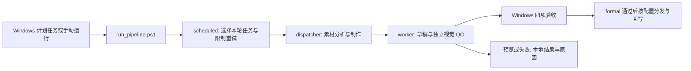

# Windows 脚本流水线

整个项目按 Windows 脚本运行。定时任务启动同一个入口，读取本地任务队列，完成素材分析、选镜、配音、剪映草稿、独立视觉 QC 和配置的交付。Python 功能模块用于维护和测试，运行只调用本机程序与 GLM／千问 API。



## 运行一轮

从 `packages/video-v1.5.3/` 执行，先用 uv 建立环境，再复制已有配置模板。模型密钥通过进程或私有配置提供。

```powershell
uv sync --frozen
New-Item -ItemType Directory -Force work | Out-Null
if (-not (Test-Path work/config.local.ps1)) { Copy-Item examples/config.example.ps1 work/config.local.ps1 }
if (-not (Test-Path work/batch_queue.json)) { Copy-Item examples/queue.example.json work/batch_queue.json }

# 在私有队列中填写真实素材和任务后，先查看本轮计划。
powershell -NoProfile -File scripts/run_pipeline.ps1 -DryRun

# 执行完整一轮。
powershell -NoProfile -File scripts/run_pipeline.ps1

# 只处理队列中的一条；仍经过相同的调度、建稿、独立质检和交付门禁。
powershell -NoProfile -File scripts/run_pipeline.ps1 -RecordId example-product-a
```

配置副本保存在忽略的 `work/config.local.ps1`。已有私有配置不要用示例覆盖。默认 Python 为包内 `.venv/Scripts/python.exe`，可用 `-PythonPath` 指定；`-WorkRoot`、`-DraftRoot`、`-QueuePath` 和 `-ConfigPath` 接受绝对路径，支持中文和空格。默认队列是 `<WorkRoot>/batch_queue.json`，默认配置是 `<WorkRoot>/config.local.ps1`。显式参数优先。

队列是 JSON 任务列表，或 `{"tasks": [...]}`。沿用既有 worker 字段：`record_id`、`title`、`script`、`product`、`category`、`sku`、`material_dir`、`count`、`voice`、`bgm` 等。素材目录必须对运行账号可读，支持本机目录和已可访问的共享目录；脚本不依赖宿主私有的挂载辅助文件。任务获取方负责把任务写入此本地队列，本入口不自行拉取飞书任务。

`delivery_mode` 只能是 `preview` 或 `formal`，省略时按预览处理。预览保留本地草稿和未认证原因。正式模式通过验收后进入配置的 NAS／表格交付；本机留稿可设置 `JY_SKIP_SHIP=1`。NAS 与飞书凭据和路径见包内 `ENVIRONMENT.md`。

单条任务、整批和计划任务都通过上述入口及同一个 dispatcher。`run.py build` 是供诊断和嵌入的底层建稿命令，不单独承担队列的独立质检与交付闭环。任务在付费步骤前因环境预检被阻断时，修好配置可从正常入口重试，不消耗建稿尝试次数。

同一机器已有另一轮运行时，新一轮返回可重试的 `DISPATCH_SUPERVISOR_BUSY_RETRY`，不异步借用对方的配置。当前轮结束后从原入口重试，定时运行也会在下一轮重新选择任务。旧版遗留的异步提交文件会保留并报 `LEGACY_SUBMISSION_REQUIRES_RECOVERY`：需先核对原任务的运行、草稿和阶段收据，再决定恢复或跳过，不能自动重放。

## 默认建稿与音乐（1.6.0）

正常入口沿用现有素材分析、选镜、配音、对齐和独立 QC，`engine.write_draft`
默认调用无头后端。BGM 空值统一自动选曲，显式路径、ID、标题优先；依据最终
画面时长生成独立音乐轨，保留选曲记录，正常成功回填同时写入 `BGM名称`。
旧音色确认保留，音乐不再要求试听确认。缺曲或有效源太短会明确阻断。

本机配置需提供 `JIANYING_HEADLESS_ROOT`、`JIANYING_INSTALL_DIR`、
`JY_HEADLESS_FONT`；`JY_DRAFT_ROOT` 指向不占用剪映首页的私有原生草稿库。
队列调度在每条任务调用配音或视觉服务前，按任务实际设置检查后端、字体、媒体工具和配置；`python -m tools.headless_runtime check` 也可单独检查默认后端。
配置示例仍需填写本机路径，不携带官方 DLL、业务缓存或凭据。

每次任务的结果记录实际版本、选镜策略及配置来源。显式 `JY_SELECTION_MODE` 若覆盖默认 `ai_editor`，运行时会提示；`legacy` 只按显式配置使用，新策略失败不会自动切回。素材诊断命令 `analyze-shots --no-vision` 不是正式建稿入口。

草稿使用原生加密时间轴及字体资源，QC、包验收、NAS 复制、重试和版本归档均
读取当前活动镜像。分发只改新副本内的素材／字体路径，源稿不动；原有正式
四项 PASS 门禁保留。旧加密编辑会话不被该新流程自动接管。显式历史恢复可选
`draft_backend=legacy`，默认不回退到旧 writer。

## 注册定时执行

下面的安装脚本把同一个完整入口注册到 Windows 任务计划程序，默认每 5 分钟一轮，可用 `-IntervalMinutes` 修改。运行身份为当前登录用户，使用隐藏窗口，重复触发时忽略并发实例；需要用户保持登录。安装脚本不会立即启动任务。

```powershell
powershell -NoProfile -File scripts/install_pipeline_task.ps1 -TaskName VideoAutomationPipeline -IntervalMinutes 5
```

安装脚本支持与运行脚本相同的路径参数。执行它会注册或更新指定名称的任务；源码更新和离线测试不会修改本机计划任务。历史 JyPoll/JyRun 入口维持退役状态。

## 状态与恢复

| 文件 | 用途 |
|---|---|
| `work/pipeline_runs/<run>.json` | 每轮任务计划、跳过原因、阶段结果和异常 |
| `work/pipeline_state.json` | 每条输入的制作与 QC 恢复次数 |
| `work/<record_id>/done.json` | 当前任务结果与交付状态 |
| `work/<record_id>/report/` | 分析、选镜、独立 QC 与失败证据 |
| `work/<record_id>/eval/` | 当前输入、草稿与自动验收结果 |

操作系统锁防止多进程重入。已完成、正在执行、普通预览和确定性失败会跳过；明确可重试的制作最多尝试两次，保留草稿的 QC／交付最多自动恢复两次，次数在开始前保存。恢复复用草稿，不重做 TTS 或选镜。同一记录的输入变化不能重置次数，必须使用新记录或显式定向恢复。不要删除整个状态文件来重放全部任务。

选镜服务超时/限流的制作重试改为阶段恢复：复用冻结的配音、句长、素材分析及完成的候选观察，仅补失败调用。每次原始运行持久记录一次恢复预算，中断也不清零；缓存缺失、输入变化或预算耗尽直接停止，不回到完整build。选镜完成后的BGM/写稿超时保留匹配结果。恢复产物和原始运行身份见[运行时与恢复](subsystems/runtime-and-recovery.md)。

有明确修复后，可使用现有入口定向恢复：`python -m tools.batch_dispatch resume --queue <queue.json> --work-root <work> --record-id <id> --stage qc`。制作缺失才使用 `--stage build`，不会因定时器重复触发而无限重建。

## 自动验收边界

`tools/acceptance` 验证当前输入、运行时身份、草稿包和独立视觉 QC。四项都必须 PASS；正式报告必须明确来自 formal 构建并绑定当前草稿及实际源素材。超时、降级、缺失／非法模式和旧状态字符串均不能放行。NAS 分发、归档和表格成功回写之前都会检查，配置观察标签也不能绕过。

Mac 交接、人工 prepare/collect、Gold 对照放行和旧批准文件已退出运行链。旧合同不能自动转为新合同；缺少构建模式或源绑定的历史报告需要补本次独立 QC，不能手改字段伪造正式来源。离线句级反馈工具仍可用于维护规则，与自动交付无关。

运行时身份绑定当前包内文件字节、配置的无头后端及策略元数据，仍不证明成片质量。离线测试和合成草稿验证同样不替代真实画面、声音与剪映可编辑性的观察。
